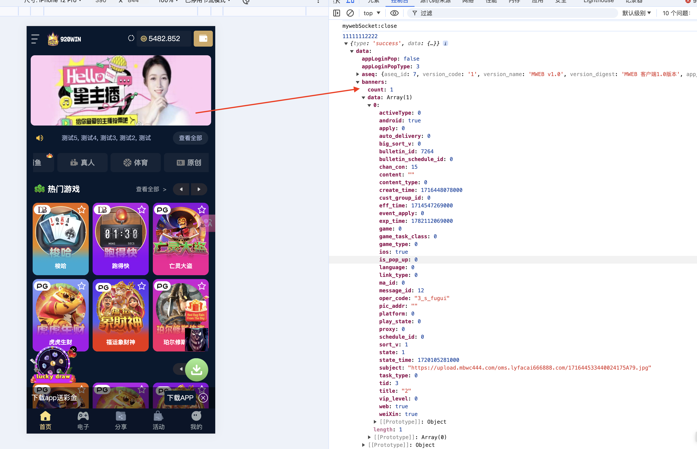
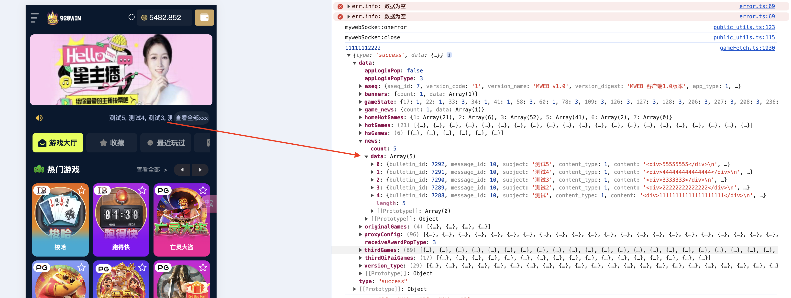

## 首页

### 1. 获取租户信息 （需查看是否有登陆后，F5不调用等逻辑）

```javascript
reqAseq();

const res = await network.request({
  cmdId: 370433,
  // 默认值 [7]， 如有浏览器参数则取浏览器参数 aseq_id
  data: [config.aseqId], 
  // 消息头类型(签名) 1:普通接口 2:鉴权接口 3:刷新AccessToken接口
  headerType: 1, 
  // paramType 参数的拼接方法 0:字符串 1:json 2:restful
  paramType: 2
});

返回消息体（仅列部分使用的）
{
  reg_addr: "http://m.180500a.com/reg?p=6f7dbed0f07e34fe41963d86f3981bba88", // 推广链接
  magic_key: "ibRMOe6oQ9ZZMItO" // 用于与原生APP交互， H5未发现用途
}

```

### 2. 域名租户关系

```javascript
fetchDefaultConfig();

const res: any = await network.request({
  cmdId: 371130,
  data: {
    /**
     * dev环境为配置域名 http://typcblack.lg0808.com
     * prod环境为当前域名 location.origin
     */
    domain_addr: domain_addr,
    language: '0'
  },
  headerType: 1,
  inHeaders: { Tid: '' }
});

返回消息体（仅列部分使用的）
// 代理盘2的时候显示xmpp，其他的时候租户名(设置浏览器title)
{
  tid: 3, // 租户ID
  area: "CNY", // 地区？？ 需要提供地区配置列表以及币种列表, C端未找到？？
  proxy: 0, // document.title = data.proxy === 2 ? .data.tenant.xmpp : data.tenant.tenant_name
  tenant: { // 代理盘相关数据
    activity_address: "cust.weicaitest.com",
    xmpp: "最沙雕的willie",
    tenant_name: "测试环境租户3",
  },
  logo_manage: [], // 用户自定义 icon 等
  listShow: [], // 代理盘控制数据， 含活动相关配置
  imgs_domain: [], // 图片线路， 类似CND图片前缀， 取能ping通的那一个 domain_addr
  sysOptions: { // ？？？
    CUST_HTML_STR: '', // 用户自定义 搜索mate标签，以及 网站分析方面的脚本。
    logo_manage: [], 
  }, 
  channelCode: "tiyupc" // 推广渠道
}
```

### 3. 获取游戏大类平台数据 reset为真重新请求
```javascript
getTotalGamesPlatform();

依赖接口2 （371130）， 当接口调用成功后调用

res = await network.request({
  cmdId: 381119,
  paramType: 1,
  isApiV2: true,
  data: data // 数据很复杂
});

返回消息体，处理的数据较多，做时核对代码 ！！！

```

### 4. 租户的彩种配置
```javascript
reqConfigJson();

依赖接口3 （381119）， 接口的 version_type，是否含有type=2， 才需要请求

const res = await network.request({
  cmdId: 320151,
  data: {
    tid: tenantInfo.value.tid // 取 371130 接口的tid
  },
  headerType: 2,
  paramType: 0,
  inHeaders: { Tid: tenantInfo.value.tid } // 取 371130 接口的tid
});

返回消息体，处理的数据较多，做时核对代码 ！！！

```

### 5. 获取所有彩票数据（不分销售状态）
```javascript
getAllLottery();

依赖接口4（320151），当接口调用成功后调用

const res = await network.request({
  cmdId: 320549,
  data: {
    tid: tenantInfo.value.tid // 取 371130 接口的tid
  },
});

```

### 6. 线路检测接口
```javascript
fetchXianlu();

依赖接口2， 当接口调用成功之后即可调用

const res = await network.request({
  cmdId: 373132,
  data: {
    tid: tenantState.tenantInfo.tid,
    domain_type: 1, // 可设置值0-10， 初始化时参数为1
  },
  headerType: 1,
});

返回消息体
[
  {
    callback_addr: "",
    chan_code: "OMS",
    clusters_id: 997,
    create_time: 1624028022000,
    domain_addr: "http://18.166.103.94:8888", // 协议与域名相关
    domain_ip: "",
    domain_line_id: 122,
    domain_type: 1,
    oper_code: "3_s_fugui",
    spare_addr: "https://livedev-k9s.qucacz.cn",
    speeds: "0.212秒",
    state: 1,
    state_time: 1624028022000,
    tid: 3,
    weight: 99
  }
]


线路接口调用完成之后，初始化socket相关推送逻辑
```

### 7. 获取客服列表
```javascript
reqServiceLists();

依赖接口2，在float组件内调用

const payload = { chan_con: 8, message_id: 50, apply: 6 };
let data = {
  state: 1,
  message_id: payload.message_id || 50,
  tid: tenantInfo.value.tid, // 平台ID
  proxy: tenantInfo.value.proxy, // 平台类型之类的值？？？
  ...payload,
  chan_code: payload.chan_code || config.chanCode, // MWEB
  language: payload.language || Number(get('languageNum') || 0), // 0
  apply: payload.apply || undefined // 6
};

// 处理后的数据
const newData = {
  state: 1,
  message_id:  50,
  tid: 3, 
  proxy: 0, 
  chan_code: 'MWEB',
  language: 0,
  apply: 6
}

const res = await network.request({
  cmdId: 380239,
  data: data,
  headerType: 2,
  paramType: 0,
  isApiV2: false
});


返回消息体, float组件取的第0个
[
  {
    avatar: "https://upload.mbwc444.com/192.168.0.104/17178289849555B664607.png",
    barcode_url: "https://upload.mbwc444.com/172.20.10.14/17179108864617B34A334.png",
    name: "https://www.youtube.com/",
    numOrConnect: "13122221111"
  }
]
```


### 8. 根据tid获取中奖排行（分页）is_clear是否清空数据 (首页中奖公告) (组件内部调用)
```javascript
reqRewardRank();

// 分页数据
let data = {
  tid: tenantInfo.value.tid,
  page_start: payload.page_start || 1,
  num_per_page: payload.num_per_page || 20
};

const res: any = await network.request({
  cmdId: 320636,
  data,
  paramType: 0,
  headerType: 1
});
```

### 9. 购彩大厅数据请求 (彩票模块 组件内部调用)
```javascript
purchaseHall();

let data = {
  ...payload,
  cust_id: userInfo.value.cust_id || '',
  tid: tenantInfo.value.tid
};

let newData = {
  cust_id: "",
  play_cat: 1,
  size: 16,
  tid: 3,
  type: 1
}

const res = await network.request({
  cmdId: 320542,
  data: data
});

返回消息体

```

### 10. 获取图形验证码 (组件内部调用， 注册及其他模块有使用)
```javascript
fetchVerifyCode();

const data = {
  ...data,
  verifycode_key: utils.uuid(32, 16),
  type: data.type || 1
};

const res = await network.request({
  cmdId: 7,
  data: data,
  headerType: 1
});
```


### 11. 用户任务方面接口 ？？？
```javascript
reqRescueFundListNew();


let data: any = {
  tid: tenantInfo.value.tid
};
if (isLogined.value) {
  data.cust_id = userInfo.value.cust_id;
}
const res = await network.request({
  cmdId: isLogined.value ? 370603 : 377212,
  data
});

返回消息体， 数据较多，需对应具体业务
```

### 12. 请求租户注册联系人配置
```javascript
reqContactConfig();

const res = await network.request({
  cmdId: 371143,
  data: {
    tid: tenantState.tenantInfo.tid
  },
  headerType: 1
});

返回消息体， 数据较多，需对应具体业务
```
   
### 13. 获取会员任务
```javascript
reqUserTaskList();


const data = {
  tid: tenantInfo.value.tid
} as any;
if (isLogined.value) {
  data.cust_id = userInfo.value.cust_id;
}

const res = await network.request( {
  cmdId: isLogined.value ? 395010 : 395014,
  data: data
});

返回消息体， 数据较多，需对应具体业务
```

### 14. 获取消息未读数量 (玩家登陆后轮训， 10s 一次)
```javascript
reqMessageUnread();

// 发起请求
let data = {
  tid: tenantInfo.value.tid,
  cust_id: userInfo.value.cust_id
};

const res: any = await network.request({
  cmdId: 375026,
  data: data,
  headerType: 2,
  paramType: 0,
  isApiV2: false
});
```


### 15. 转换所有余额 (玩家登陆即可调用 , 不知具体用途及调用时机 ？？？？)
```javascript
reqTransitionAllYe();

// 初始化调用参数
let data:any = {
  tid: tenantInfo.value.tid,
  cust_id: userInfo.value.cust_id,
  type: 1
}

const params = {
  cmdId: 391138,
  data: data,
  headerType: 2,
  paramType: 0
};
```

### 16. 获取红包数据 (组件内部调用)
```javascript
reqHB();

let data: any = {
  cust_id: userInfo.value.cust_id,
  tid: tenantInfo.value.tid
};

const res = await network.request({
  cmdId: 382233,
  data
});
```


### 首页banner
数据来自 cmdId: 381119 接口


```text
subject 图片显示使用 subject 字段

content 有点击逻辑
1. 字符串含有 http， 打开链接
2. 不包含http， 当前url做替换处理，跳转web路由  router.push(content.replace('/#', ''))
```

### 公告数据
数据来自 cmdId: 381119 接口



```text
title： 用于外层显示，逗号拼接 title 字段

content： 用于点击更多的弹窗， 支持 swiper 左右滚动

```