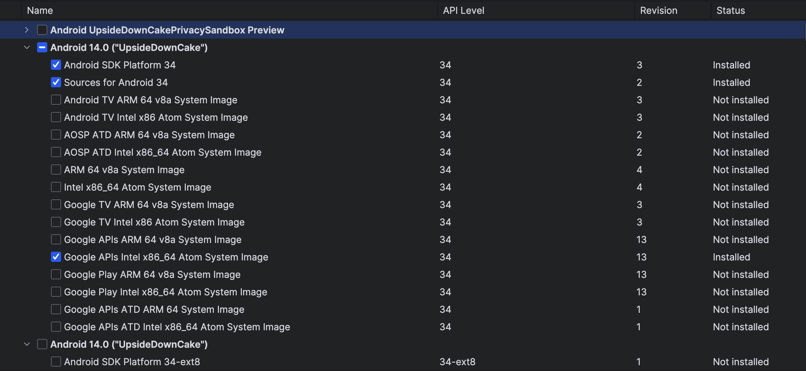
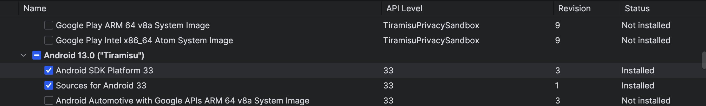
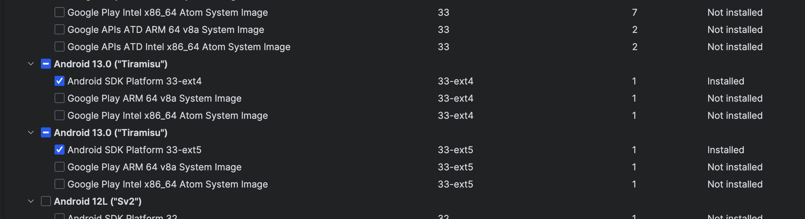
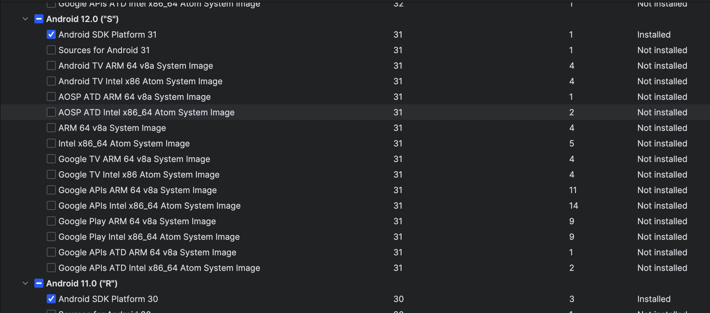
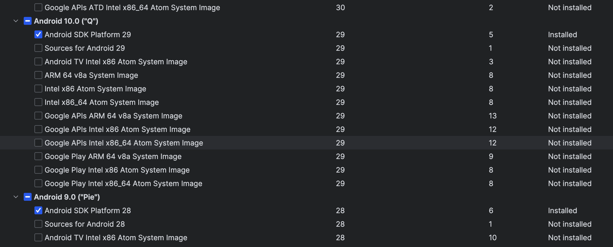

# Sg.Flutter

A new Flutter project.

## Getting Started

This project is a starting point for a Flutter application.

A few resources to get you started if this is your first Flutter project:

- [Lab: Write your first Flutter app](https://docs.flutter.dev/get-started/codelab)
- [Cookbook: Useful Flutter samples](https://docs.flutter.dev/cookbook)

For help getting started with Flutter development, view the
[online documentation](https://docs.flutter.dev/), which offers tutorials,
samples, guidance on mobile development, and a full API reference.

## 项目配置

* Flutter.SDK 版本控制在 3.7.12

  * ```shell
    #! /bin/sh
    
    # 获取当前脚本文件的目录
    current_directory=$(dirname "$(readlink -f "$0")")
    echo $current_directory
    cd $current_directory/android
    
    flutter doctor -v
    fvm flutter --version
    fvm flutter pub get
    flutter precache
    ```

* Android api

  

  

  

  

  
  
* Dart.sdk：需要在IDE里面关联最新的Flutter.sdk的dart.sdk路径

## 其他

* Android打包，请修改 `android/app/hot.gradle` 文件，改为**release**模式

* iOS同步证书命令（复制 点开左下角terminal 贴贴） 

  * 前置条件：安装了fastlane 

  ```shell
  brew install fastlane
  ```

  * ```shell
    cd ios
    fastlane match_all
    ```
  
  * 强制更新开发者账号证书命令
  
    ```
    fastlane force_match
    ```
  
  * iOS真机运行命令  
  
    环境参数：`dev test release`
  
    ```shell
    flutter run --dart-define=APP_TIME=$(date +%m-%d_%H-%M-%S) --dart-define=APP_ENV=dev
    ```
  
  * iOS 打包命令
  
    ```shell
    flutter build ipa --dart-define=APP_TIME=$ipatime --dart-define=APP_ENV=dev --export-options-plist./ios/${profile}ExportOptions.plist
    ```

## 一些日志输出

* 2023-12-28 15:02 再次国际化翻译前存档
* 2024-1-22 16:57 再次国际化翻译前存档
* 2024-1-29 18:09 再次国际化翻译前存档
* 2024-1-31 15:23 再次国际化翻译前存档
* 2024-2-6 13:51 再次国际化翻译前存档
* 2024-2-26 20:18 再次国际化翻译前存档
* 2024-2-28 14:18 再次国际化翻译前存档
* 2024-2-29 14:55 再次国际化翻译前存档
* 2024-3-2 11:04 再次国际化翻译前存档
* 2024-3-5 再次国际化翻译前存档
* 2024-3-9 再次国际化翻译前存档
* 2024-3-13 再次国际化翻译前存档
* 2024-3-14 再次国际化翻译前存档
* 2024-3-28 再次国际化翻译前存档
* 2024-4-5 再次国际化翻译前存档
* 2024-4-23 再次国际化翻译前存档